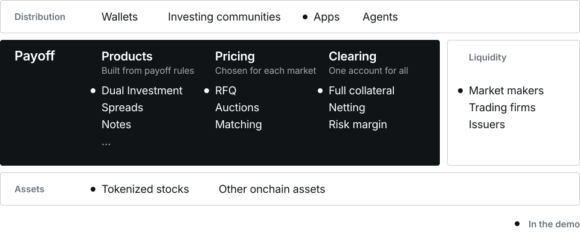
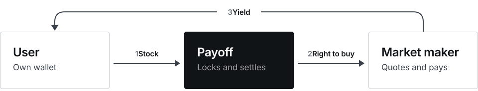
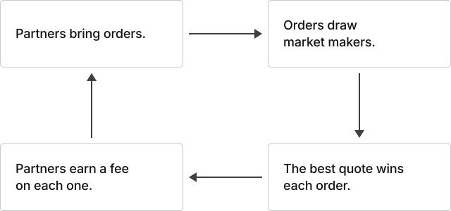
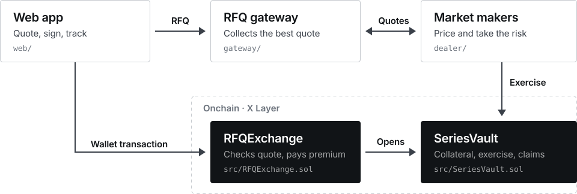

# Payoff

**The onchain layer for structured products.**

Wallets and investing communities sell the products, market makers price them, and Payoff clears every position onchain. Users trade from their own wallets.

The first product is Dual Investment on tokenized stocks: earn on your tokenized stocks, from your own wallet. It is live on X Layer testnet.

2nd place, Market track · OKX Dev Day 2026

[Investor deck (PDF)](pitch/Payoff-deck.pdf) · [Live app](https://www.payoff.finance) · [Demo video](https://youtu.be/yzgw6kbK_JQ) · [How it works](https://www.payoff.finance/how-it-works)

## Why now

- **Tokenized stocks grew 5x in a year**, from $0.65B to $3.2B onchain, held by 4.3 million addresses. Only $338M of that is active in DeFi protocols. Most tokens just sit in wallets.
- **Packaged as products, options already sell at scale.** US structured products sold $197B in 2025. In July 2026 OKX, Bybit and Bitget each launched Dual Investment on 10 to 21 tokenized stocks. It only works inside the exchange.

<sub>Sources: rwa.xyz, 8 Oct 2026 · DefiLlama, 5 Oct 2026 · SRP, US full year 2025 · Odaily, Bybit and crypto.news, Jul to Aug 2026</sub>

## The platform

Sold by many partners. Cleared in one place.

<picture>
  <source media="(prefers-color-scheme: dark)" srcset="assets/readme/platform-dark.svg">
  
</picture>

Partners bring orders. Market makers price them and take the risk. Payoff defines each product from its payoff rules, uses a pricing method suited to each market, and clears every position. New products, such as spreads and notes, plug into the same layer.

**Today:** the X Layer testnet demo runs one path through every layer, marked with a dot: an app, Dual Investment, RFQ pricing, fully collateralized clearing, one market maker and tokenized stocks.

## The first product: Dual Investment

Like a limit order that pays upfront. The user picks a price and a date to **Sell High** or **Buy Low** and receives a yield immediately. A contract holds the collateral, not an exchange.

<picture>
  <source media="(prefers-color-scheme: dark)" srcset="assets/readme/trade-dark.svg">
  
</picture>

The yield is an option premium. **Sell High** (shown) is a covered call: the user locks stock, and a market maker buys the right to buy it at the target price. **Buy Low** is a cash-secured put: the same flow with USDG. The user keeps the premium in either outcome.

## Why onchain

4.3 million addresses already hold tokenized stocks. Exchange products need the stock deposited first.

| | Inside an exchange | Onchain with Payoff |
| --- | --- | --- |
| Who holds the stock | The exchange | **Non-custodial.** A contract holds it, not a company. |
| Who sets the price | The exchange | **Open quoting.** Any approved market maker can quote each order. |
| Who can offer it | Only the exchange | **Open distribution** (planned). Any wallet or community can offer it and earn a fee. |

**Today:** one app and one market maker, both operated by Payoff.

## Why it works

Orders are the hard part. Partners bring them.

<picture>
  <source media="(prefers-color-scheme: dark)" srcset="assets/readme/flywheel-dark.svg">
  
</picture>

Three choices:

- **Sell to holders, not options traders.** Options traders already have a home: Derive handles about 84% of onchain options volume.
- **The market maker who takes the risk sets the price.** Formula-priced pools lost money when volatility jumped, per Lyra's 2021 stress tests.
- **Fees on real trades. No token at launch.** Ribbon's token rewards stopped growing TVL. Friktion's costs outpaced its revenue.

<sub>Sources: DefiLlama, 30-day options volume, 8 Oct 2026 · Lyra research, 17 Jul 2021 · Ribbon RGP-31, 27 Jan 2023 · CoinDesk on Friktion, 31 Jan 2023</sub>

## Business model

Payoff takes a share of each premium.

- **10% of each premium** as the protocol fee (testnet setting). The user keeps the rest.
- **Partner fee** (planned). A wallet or community that offers Payoff earns a fee.
- **About $2.3M a year per $100M of TVL** (estimate), assuming weekly premiums of 0.45% and the 10% fee.

Next: a security audit, the first outside wallet, and call and put spreads.

## Try it on X Layer testnet

1. Switch a browser wallet to **X Layer Testnet** (chain ID 1952) and get test OKB from the [OKX faucet](https://web3.okx.com/xlayer/faucet/xlayerfaucet).
2. Get test NVIDIA (for Sell High) or test USDG (for Buy Low) at [payoff.finance/faucet](https://www.payoff.finance/faucet).
3. Open [Sell High](https://www.payoff.finance/sell-high) or [Buy Low](https://www.payoff.finance/), pick a target price and a date, and get a quote.
4. Confirm the quote in the wallet. The yield arrives in the same transaction.
5. Track the position and claim settled assets in [Portfolio](https://www.payoff.finance/positions).

All tokens are project test assets with no monetary value.

## Under the hood

The code behind the demo path: offchain services above, contracts on X Layer below.

<picture>
  <source media="(prefers-color-scheme: dark)" srcset="assets/readme/code-dark.svg">
  
</picture>

- **RFQExchange** (one, shared) verifies EIP-712 or ERC-1271 quote signatures, market-maker and Vault admission, fees, deadlines, nonces and the user's execution limits. It moves the premium and opens the position atomically.
- **SeriesVault** (one per stock) holds collateral, records series and positions, and handles exercise and claims. Positions carry nontransferable ERC-1155 receipts. Pausing new trades never blocks existing exits.
- **RFQ gateway** collects quotes concurrently, checks signatures and funding, simulates execution and recommends the highest net premium. It holds no pricing logic and no signing keys.
- **Market maker.** The live market maker runs a proprietary pricing model, kept private. The open [reference dealer](dealer/README.md) quotes 50% of the listed option bid, and also runs settlement monitoring and opt-in automatic exercise.
- **Web app** on Next.js, hosted on Vercel. Positions are read from the Vault's onchain holder index, so no event-log scan is needed.

### How a position settles

Each position fixes a wrapped-stock quantity **W** and a USDG amount **U**. The market maker can exercise during the series exercise window.

| Strategy | User locks | If the market maker exercises | If the position expires unexercised |
| --- | --- | --- | --- |
| Buy Low | U USDG | Market maker delivers W wrapped stock and receives U; user claims W | User reclaims U |
| Sell High | W wrapped stock | Market maker pays U and receives W; user claims U | User reclaims W |

Exercise is a market-maker action, not an automatic trigger on the stock price, and settlement needs no price oracle. Settlement uses wrapped stock units: corporate actions change the underlying quantity those units represent, and the Vault does not adjust positions for them. See the [fixed-token settlement design](design/fixed-token-settlement.md).

### Testnet deployment

Network: X Layer Testnet (1952), RPC `https://testrpc.xlayer.tech/terigon`. The full configuration is in [config/xlayer-testnet.json](config/xlayer-testnet.json), and the [testnet deployment guide](script/README.md) covers deployment, series publication and the test assets.

| Contract | Address |
| --- | --- |
| RFQExchange | [0x8D59286d1b728599bA897436cC6C3Ce1a8DB6D6a](https://www.okx.com/web3/explorer/xlayer-test/address/0x8D59286d1b728599bA897436cC6C3Ce1a8DB6D6a) |
| NVDA SeriesVault | [0x0d90A6561D8F9399dB6Bb9E8CafbB43269a6f90d](https://www.okx.com/web3/explorer/xlayer-test/address/0x0d90A6561D8F9399dB6Bb9E8CafbB43269a6f90d) |
| Payoff Test USDG (tUSDG) | [0x56C62A3d7b0B7F0fC32F88635B4Ab140C02B3B53](https://www.okx.com/web3/explorer/xlayer-test/address/0x56C62A3d7b0B7F0fC32F88635B4Ab140C02B3B53) |
| Test NVIDIA (tNVDAx) | [0x1DDa57B38E0461a29c0281497c15fb77657450Eb](https://www.okx.com/web3/explorer/xlayer-test/address/0x1DDa57B38E0461a29c0281497c15fb77657450Eb) |
| Wrapped Test NVIDIA (twNVDAx) | [0x691fFBCd11f0bA0B58D387B9f2649F6393b71E57](https://www.okx.com/web3/explorer/xlayer-test/address/0x691fFBCd11f0bA0B58D387B9f2649F6393b71E57) |
| Test NVIDIA faucet | [0xbf13995d37742a5fe09c768ac79157068215a4b2](https://www.okx.com/web3/explorer/xlayer-test/address/0xbf13995d37742a5fe09c768ac79157068215a4b2) |

### Repository map

| Path | Responsibility |
| --- | --- |
| [src/RFQExchange.sol](src/RFQExchange.sol) | Shared execution entry point and admission controls |
| [src/SeriesVault.sol](src/SeriesVault.sol) | Stock-specific series, positions, collateral, exercise and claims |
| [src/](src/) | Shared types, position receipts and exact-transfer library |
| [sdk/](sdk/) | Quote signing, typed data and wrapped-asset conversions |
| [gateway/](gateway/README.md) | TypeScript / Fastify / viem / PostgreSQL RFQ service |
| [dealer/](dealer/README.md) | Reference market maker, settlement monitor and automatic exercise |
| [web/](web/README.md) | Next.js / React / TypeScript frontend |
| [test/](test/) | Contract lifecycle, fuzz, invariant, SDK and asset fork tests |
| [config/](config/) | Public mainnet asset and testnet deployment configuration |
| [script/](script/README.md) | X Layer testnet deployment procedure and test assets |
| [pitch/Payoff-deck.pdf](pitch/Payoff-deck.pdf) | Investor deck |

### Run and verify

Requirements: Node.js 24, npm and Git. Foundry is pinned through npm; no global installation is needed.

```sh
git clone --recurse-submodules https://github.com/cl-fi/payoff-xlayer.git
cd payoff-xlayer
npm ci
npm run dev:web
```

Open [localhost:3000](http://localhost:3000); the frontend connects to the deployed testnet contracts and gateway. For a simulated flow, set `NEXT_PUBLIC_DATA_MODE=demo` in `web/.env.local`. See the [frontend guide](web/README.md).

Main checks, also run in CI:

```sh
npm run fmt:check && npm run build && npm test && npm run test:sdk
npm run build:gateway && npm run test:gateway && npm run test:dealer
npm run test:gateway:integration
npm run test:integration --workspace @payoff/self-dealer
npm run test:web && npm run build:web && npm run test:web:e2e
```

- Contract tests cover both strategies, quote validation, lifecycle transitions, fuzz cases and multi-market accounting invariants. Contracts use Solidity 0.8.30 with the Paris EVM target.
- SDK checks compare a committed EIP-712 vector with Solidity and exercise integer rounding and wrapped-asset conversions.
- Integration tests deploy the actual Exchange and Vault on a local Anvil chain and run the gateway, reference dealer, frontend wallet flow and settlement against them. Database tests use PGlite locally unless `TEST_DATABASE_URL` is set; CI uses PostgreSQL 17.
- Frontend tests cover both strategies, settlement outcomes, quote expiry, account changes and desktop/mobile layouts.

Optional fork tests against the real NVDAx, wNVDAx and USDG contracts on X Layer mainnet (block 70,938,201) need an RPC: `npm run test:fork`. Override it with `XLAYER_RPC_URL`.

### Status

This is a testnet MVP, not an audited production release. Contracts have no proxy upgrade path, administrator withdrawal or price oracle. Hedging and mainnet deployment are future work.

## Team

**Chenjie Lyu**, founder. Product lead and full-stack engineer who built all of Payoff alone: contracts, quote gateway, market maker service and app. Before Payoff: founding member of Arttoo (2024 to 2026), an RWA startup on Sui, leading its tokenization platform from zero to launch and designing its lending protocol's capital structure. Also prototyped onchain options and Dual Investment on Sui.

## Contact

Partnering or investing? Telegram [@cl_dev](https://t.me/cl_dev) · chenjie.lyu@payoff.finance · [github.com/cl-fi](https://github.com/cl-fi)
